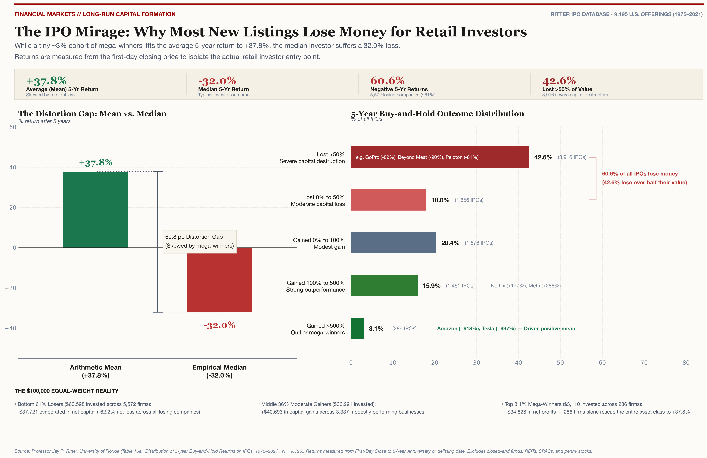
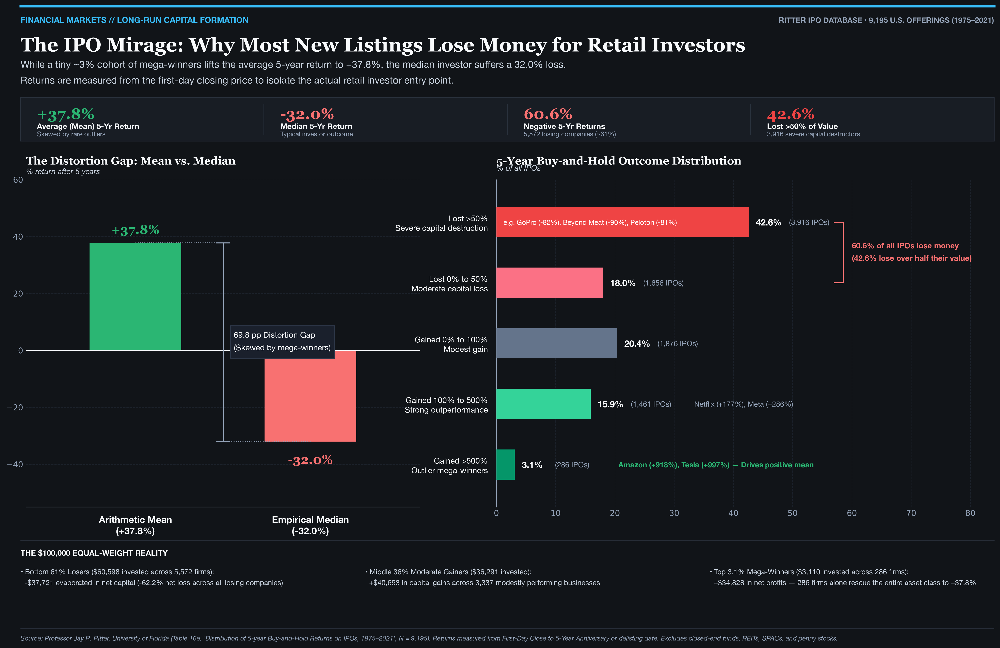

# The IPO Mirage: Why Most New Listings Lose Money for Retail Investors

> **[AI Generated]**

### Empirical Evidence from Professor Jay Ritter's University of Florida IPO Database
*(Table 16e: Distribution of 5-Year Buy-and-Hold Returns on IPOs, 1975–2021, N = 9,195)*

[](#)
[](https://colab.research.google.com/github/kanishk307/ipo-analysis/blob/main/ipo_5yr_skew_analysis.ipynb)
[](https://www.python.org/downloads/)
[](LICENSE)
[-990000.svg)](https://site.warrington.ufl.edu/ritter/ipo-data/)
[-10B981.svg)](#visualizations)

---

## Executive Summary

When retail investors read that the average 5-year return on Initial Public Offerings (IPOs) is **+37.8%**, they assume that buying newly public companies is a reliably profitable strategy. 

**It is not.**

Behind that deceptive arithmetic average lies one of the most extreme cases of positive statistical skewness in financial economics:

```
┌────────────────────────────────────────────────────────────────────────┐
│                        THE 5-YEAR IPO REALITY                          │
│                                                                        │
│   Average (Mean) 5-Year Return:    +37.8%  (Heavily skewed)            │
│   Median 5-Year Return:            -32.0%  (Typical retail outcome)    │
│   ──────────────────────────────────────────────────────────────       │
│   The Distortion Gap:               69.8 percentage points             │
│                                                                        │
│   Percentage Losing Money:          60.6%  (~61% of all IPOs)          │
│   Percentage Losing >50% Value:     42.6%  (3,916 severe destructors)  │
│   Top Outliers (>500% Return):       3.1%  (286 mega-winners)          │
└────────────────────────────────────────────────────────────────────────┘
```

The median retail investor who buys an IPO on Day 1 loses **nearly a third (-32.0%)** of their capital over a 5-year holding horizon. More than **60% of all IPOs generate negative buy-and-hold returns**, and more than **42% lose over half their value**.

The positive arithmetic mean (+37.8%) is an artifact of the power-law right tail: a tiny ~3% cohort of mega-winners (such as Amazon and Tesla) generated thousands of percentage points in returns, single-handedly pulling the entire asset class average into positive territory.

---

## Visualizations

The analysis generates two publication-grade, 300 DPI graphics in light and dark themes (pure typographic and data-ink clarity).

### 1. Light


### 2. Dark


---

## Core Findings & Breakdown

### 1. Headline Empirical Metrics (Ritter Table 16e, Panel C)

All figures reflect buy-and-hold returns measured from the **First-Day Closing Price** to the **5-Year Anniversary** (or delisting date) across **9,195 U.S. operating company IPOs** between 1975 and 2021.

| Metric | Empirical Value | Context & Investor Implication |
| :--- | :---: | :--- |
| **Total IPOs Tracked** | **9,195** | Complete 46-year dataset of U.S. operating companies |
| **Average (Mean) 5-Year Return** | **+37.8%** | Deceptive benchmark pulled upward by rare right-tail outliers |
| **Median 5-Year Return** | **-32.0%** | The true experience of a randomly selected IPO |
| **Distortion Gap (Mean vs. Median)** | **69.8 pp** | The mathematical spread caused by severe positive skewness |
| **Negative 5-Year Return %** | **60.6%** | **5,572 out of 9,195 IPOs lost money** for retail buyers |
| **Severe Capital Loss (>50% Drop)** | **42.6%** | **3,916 IPOs lost more than half their value** |
| **Positive 5-Year Return %** | **39.4%** | Only 3,623 out of 9,195 IPOs gained value |

---

### 2. The 5-Year Outcome Spectrum

Where do IPOs actually end up 5 years after their market debut?

| Return Bracket | Number of IPOs | % of Universe | Classification | Real-World Examples |
| :--- | :---: | :---: | :--- | :--- |
| **Lost > 50%** | **3,916** | **42.6%** | Severe Capital Destruction | GoPro (-82%), Beyond Meat (-90%), Peloton (-81%) |
| **Lost 0% to 50%** | **1,656** | **18.0%** | Moderate Capital Loss | Underperformed broad market indices |
| **Gained 0% to 100%** | **1,876** | **20.4%** | Modest Gain | Benchmark matching |
| **Gained 100% to 500%** | **1,461** | **15.9%** | Strong Outperformance | Netflix (+177%), Meta (+286%) |
| **Gained > 500%** | **286** | **3.1%** | Outlier Mega-Winners | Amazon (+918%), Tesla (+997%) |

> **Key Takeaway:** The bottom two categories combined represent **60.6% of all IPOs**. If you pick an IPO at random, you are nearly **three times more likely** to lose more than half your money (42.6%) than to achieve a mega-winner return (3.1%).

---

### 3. The $100,000 Equal-Weighted Portfolio Reality

To understand the mechanics of this skewness, consider an investor who allocated **$100,000 equally across all 9,195 IPOs** ($10.88 invested in every company on its first closing day):

```
$100,000 EQUAL-WEIGHT ALLOCATION SKEW ANATOMY:
────────────────────────────────────────────────────────────────────────────────────────
• Initial Capital:                     $100,000.00
• Final 5-Year Portfolio Value:        $137,800.00 (+37.8% overall return)
• Total Net Profit:                    +$37,800.00

WHERE THE CAPITAL WENT:
1. Bottom 61% Losers ($60,598 allocated across 5,572 firms):
   -$37,721 evaporated in net capital (-62.2% net loss across losing companies)
   * The 3,916 severe losers (>50% drop) alone destroyed -$33,219 of capital.

2. Middle 36% Moderate Gainers ($36,291 allocated across 3,337 firms):
   +$40,693 generated in capital gains.

3. Top 3.1% Mega-Winners ($3,110 allocated across 286 firms):
   +$34,828 in net profits generated.
────────────────────────────────────────────────────────────────────────────────────────
```

**The Core Insight:** The top ~3% of companies (286 firms) generated **+$34,828** in net profit from an initial allocation of just **$3,110**. This tiny elite cohort completely absorbed the **-$37,721 loss** suffered by the bottom 5,572 companies and pushed the total portfolio return into positive territory (+37.8%). 

Without these rare power-law winners, an equal-weighted IPO basket suffers devastating losses.

---

### 4. Real-World Case Studies (via Yahoo Finance)

To validate the empirical distribution against live market history, the pipeline queries daily price series for iconic market offerings from their **First-Day Close** to their **5-Year Anniversary**:

| Ticker | Company | IPO Date | 5-Year Mark | Day 1 Close | 5-Yr Close | 5-Yr Return | Empirical Classification |
| :--- | :--- | :---: | :---: | :---: | :---: | :---: | :--- |
| `AMZN` | Amazon | 1997-05-15 | 2002-05-15 | $0.10 | $1.00 | **+918.2%** | Mega-Winner (>500%) |
| `TSLA` | Tesla | 2010-06-29 | 2015-06-29 | $1.59 | $17.47 | **+996.8%** | Mega-Winner (>500%) |
| `META` | Meta (Facebook) | 2012-05-18 | 2017-05-18 | $37.87 | $146.26 | **+286.2%** | Strong Winner (100–500%) |
| `NFLX` | Netflix | 2002-05-23 | 2007-05-23 | $0.12 | $0.33 | **+176.9%** | Strong Winner (100–500%) |
| `UBER` | Uber Technologies | 2019-05-10 | 2024-05-09 | $41.57 | $67.93 | **+63.4%** | Modest Winner (0–100%) |
| `SNAP` | Snap Inc. | 2017-03-02 | 2022-03-02 | $24.48 | $37.37 | **+52.7%** | Modest Winner (0–100%) |
| `GPRO` | GoPro | 2014-06-26 | 2019-06-26 | $31.34 | $5.62 | **-82.1%** | Severe Loser (<-50%) |
| `BYND` | Beyond Meat | 2019-05-02 | 2024-05-01 | $1972.50 | $203.70 | **-89.7%** | Severe Loser (<-50%) |
| `PTON` | Peloton | 2019-09-26 | 2024-09-25 | $25.76 | $4.88 | **-81.1%** | Severe Loser (<-50%) |

---

## Research Methodology & Frequently Asked Questions

### Which companies and time period are included?
- **Company Universe:** **9,195 U.S. operating companies** that listed on major national exchanges (NYSE, Nasdaq, AMEX) between **1975 and 2021**.
- **Data Integrity Filters:** As defined by Professor Jay Ritter, the dataset rigorously excludes non-operating vehicles: closed-end funds, Real Estate Investment Trusts (REITs), Special Purpose Acquisition Companies (SPACs / blank checks), unit offerings, American Depositary Receipts (ADRs), and penny stocks (<$5.00 offer price).
- **Time Horizon:** Issuers from 1975 to 2021 are tracked for **5 full years** (realized return horizon: **1975 through 2026**). If a company delisted before 5 years due to bankruptcy, merger, or acquisition, its terminal return is incorporated.

### Why measure from the First-Day Close instead of the Offer Price?
Institutional investors and syndicate insiders purchase shares at the IPO Offer Price, capturing the initial "first-day pop". Retail investors, however, can almost never access shares at the offer price; they must buy on the secondary market at or after the first-day opening/closing price. Measuring from the **First-Day Close** reflects the actual economics experienced by retail market participants.

### Is this phenomenon unique to the United States?
**No.** While the exact figures (+37.8% Mean, -32.0% Median, 60.6% Losers, 69.8 pp Spread) are calculated from U.S. capital markets, multi-country academic studies across **40+ countries** (e.g., Loughran, Ritter, & Rydqvist) establish that:
1. **Global Underperformance:** In virtually every major economy (UK, Germany, France, Japan, China, India, Canada, Australia, Brazil), IPOs significantly underperform seasoned domestic equity benchmarks over 3-to-5-year holding horizons (typically by 20% to 40%).
2. **Universal Right-Skewness:** In all international markets, long-run returns are heavily right-skewed. The median outcome is negative, and a small elite group of national champions accounts for virtually all asset-class wealth creation.

---

## Repository Structure

```
ipo-analysis/
├── ipo_5yr_skew.py             # Single-file production analysis & chart pipeline
├── ipo_5yr_skew_analysis.ipynb # Google Colab & Jupyter interactive notebook
├── ipo_5yr_skew_chart.png      # Light Chart (300 DPI)
├── ipo_5yr_skew_chart_dark.png # Dark Chart (300 DPI)
├── ipo_5yr_summary_metrics.csv # Headline metrics table export
├── ipo_5yr_return_buckets.csv  # 5-year empirical outcome buckets export
├── article_stats_summary.txt   # Formatted text research brief & stats export
├── requirements.txt            # Minimal, portable dependency specification
├── LICENSE                     # MIT License
└── README.md                   # Comprehensive research report & documentation
```

---

## Quick Start & Execution

### 1. Run in Google Colab (One-Click)
Open the notebook directly in your browser:  
[](https://colab.research.google.com/github/kanishk307/ipo-analysis/blob/main/ipo_5yr_skew_analysis.ipynb)

### 2. Run Locally

#### Prerequisites
- Python 3.9+ installed.

#### Setup Virtual Environment
```bash
# Clone the repository
git clone https://github.com/kanishk307/ipo-analysis.git
cd ipo-analysis

# Create and activate virtual environment
python3 -m venv .venv
source .venv/bin/activate  # On Windows: .venv\Scripts\activate

# Install dependencies
pip install -r requirements.txt
```

#### Execute Analysis & Generate All Outputs
```bash
# Full execution: queries live yfinance data, generates CSVs, and renders both 300 DPI charts
python ipo_5yr_skew.py
```

#### CLI Options
```bash
# Render only the Light chart
python ipo_5yr_skew.py --theme light

# Render only the Dark chart
python ipo_5yr_skew.py --theme dark

# Run fast offline execution (skips network calls using verified baseline data)
python ipo_5yr_skew.py --offline

# Specify custom chart DPI resolution (e.g. 600 DPI for ultra-high-res print)
python ipo_5yr_skew.py --dpi 600
```

---

## Citation & Academic Credits

The empirical data foundation for this research originates from the historical IPO database maintained by **Professor Jay R. Ritter** at the University of Florida Warrington College of Business:

- **Primary Source:** Ritter, Jay R., *Table 16e: Distribution of 5-year Buy-and-Hold Returns on IPOs, 1975–2021* (Panel C: Returns Measured from First-Day Close).
- **Database URL:** [https://site.warrington.ufl.edu/ritter/ipo-data/](https://site.warrington.ufl.edu/ritter/ipo-data/)
- **Related Foundational Research:**
  - Ritter, Jay R. (1991). "The Long-Run Performance of Initial Public Offerings." *The Journal of Finance*, 46(1), 3–27.
  - Loughran, Tim, and Jay R. Ritter (1995). "The New Issues Puzzle." *The Journal of Finance*, 50(1), 23–51.
  - Loughran, Tim, Jay R. Ritter, and Kristian Rydqvist (1994). "Initial Public Offerings: International Insights." *Pacific-Basin Finance Journal*, 2(2), 165–199.

---

## License

This project is licensed under the [MIT License](LICENSE) — free for academic, journalistic, educational, and commercial use with attribution.
